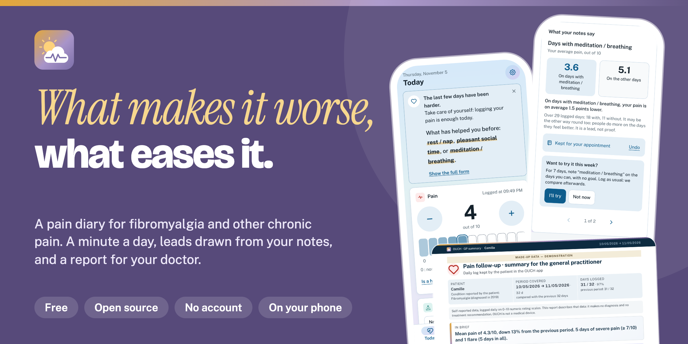

# OUCH 🌤️

*Ouch, Understand, Chart, Heal*

**[maxauvy.github.io/OUCH](https://maxauvy.github.io/OUCH/)** · License [CeCILL v2.1](#license) · French and English · [Changelog](CHANGELOG.md) (in French) · [Version française](README.md)



OUCH is a pain diary for fibromyalgia and other chronic pain. You log your day in under a minute, everything stays on your phone, and you always decide what to share, and with whom.

Existing pain trackers (Pain Diary, MyPainDiary…) are either closed or a chore to use on the days when you have nothing left. OUCH takes the opposite approach: big buttons, almost nothing to fill in, and no data leaving your device unless you decide it should.

## Why install it

**Track, in under a minute.** Pain alone is enough for a day to count; the rest (sleep, where it hurts, treatments, weather) is optional, and on the hardest days the screen gets lighter. Installed on your home screen, the app opens in one tap and works offline. No account: the diary stays on your phone.

**Understand, without promising anything.** Over time your notes start to tell you things: what comes before a flare, what comes back on the good days. OUCH shows associations, never causes: you keep what speaks to you and set the rest aside. You walk into your appointment with a report that says what happened, instead of digging through memory.

**Ease it, with the gestures that work for you.** You note what helped (a short walk, a hot bath, stretching…). You can try one of those actions for a week and put your days with and without side by side. When a flare ends, the app tells you how many days it took for your pain to get back to its usual level. No score, no streak, A “A moment to breathe” screen offers, offline, a slow breathing exercise and two short relaxation exercises, with nothing noted or counted. The “For you” list can also remind you, without judgement, of missed doses of a background treatment, and what studies say about exercise for the illness you track, with their sources (Settings › Scientific sources). All of it lives in the “Relief” tab, with “My plan for hard days” (a few lines you write ahead of time) and “My go-to moves” (what helps you, with a timer whose length you choose). No score, no streak, nothing to lose.

OUCH is free software and free of charge, and it is a diary, not medical advice: it makes no diagnosis and recommends no treatment.

## What you can do

### Log your day

Pain alone, on a scale from 0 to 10, is enough for a day to count. You can add fatigue, sleep, stress, brain fog, mood, activity, where it hurts, the day's weather (from your location or entered by hand) and, if you want, your cycle. You can also note what helped: a short walk, a hot bath, some meditation… Anything you don't use can be switched off in the settings.

“Where does it hurt?” is entered on a body outline, front and back: you tap a large region, then pick the part and the side, left or right (25 zones, including the 19 regions doctors know).

The first time you open the app, a setup guide offers to get things ready: the conditions you track, your first name, your treatments, a daily reminder. Depending on the conditions you give, it sorts the indicators into three tiers (recommended, also useful, all the others); fourteen newer indicators come with it (morning stiffness, night waking because of pain, difficulty with daily movements, joints, periods, headache, leg, spasms…). Quickly reviewed in October 2026 by a physiotherapist, a psychologist specialised in pain and a GP, they remain simple scales or answers, **not validated**, with no score or threshold. Everything is optional, you can skip it at any point and run it again from the settings.

On flare days the screen gets lighter and the app suggests nothing: only a kind word. On other days, whatever is waiting for you (a lead, a trial under way, a recap, yesterday to log) fits in one quiet line, “2 small things for you”, which opens a sheet.

When a stretch is harder, you can note it yourself under the day's pain: when it began, what may have played a part, a few words. The screen then gets lighter, as for a detected flare, but the two stay apart: OUCH does not mix what you live with what the pain levels show.

### Keep track of your treatments

You enter each treatment once: regular or as-needed, the dose, dose changes, when you stopped. After that, regular treatments are ticked for you every day. For as-needed ones, you log how many doses you took, how much relief you got and any side effects. Dose changes show up right on the pain curve.

### Share your weather of the day

The day's measures are boiled down to a single picture, from clear skies to a storm, with pain, fatigue and mood. You can add a short note and send it to your loved ones yourself. Nothing is ever sent automatically.

### Journal and trends

The journal is a monthly calendar, colored by each day's weather. You can go back and fix any day.

Trends opens with a “For my appointment” block (average pain, flares, most reported zone, latest treatment change). Then come the pain curve over 7, 30 or 90 days, or since the beginning, with its 7-day average and toggleable layers (flares, treatments, trials), a “What happened” timeline, cards on painful zones (where, during flares, week by week) and a calm recap of the month that just ended. It also shows which days of the week tend to go best and worst, what your notes let you see (“what your notes say”: sleep, stress, the day before's activity and what helped, one lead at a time, with the two averages and the number of days), and how you use your treatments. These are associations found in your own data, not proof, and the app says so. You can keep a lead for your appointment, set it aside, or try for a week an action you noted yourself; the app can also bring a lead to the day's page, sum up your week in a sentence on Sundays, or do it quietly with a dot on the tab (all of it is turned off by a single “Suggestions” setting, and none of it shows during a flare). When a trial or a flare ends, the app acknowledges it in one gentle sentence.

Two more cards: “Compare two periods” puts the same measures side by side (the last 30 days, since your last appointment, or two periods you choose) and reads the pain gap beside what is usual for you; “After your active days” looks, from 30 days logged with the activity, at whether the days after your most active ones were harder than usual, and sets it beside what chance would give. Neither says why: they are descriptions, not proof. The day after a day you gave a lot, a quiet word suggests taking it in small steps, never during a harder stretch. If you turn it on (off by default, with automatic weather), a line in “For you” also says when the pressure is due to fall tomorrow and your diary shows the days it fell were harder than chance gives; otherwise, nothing.

### Get ready for an appointment

You note the date, your questions and what you most want to talk about; a soft card on the day's page recalls it fifteen days ahead. After the appointment you write what the doctor said and, if a prescription was given, its length: OUCH reminds you a week before it ends (or two, as you choose), without working anything out from your intakes. The sheet also recalls what happened since your last appointment. All of it stays on the device.

### A sheet for a professional who does not know you

For the emergency room or a new doctor, the Consultation tab makes a page to show or print: the illnesses you track and their status, your current treatments, the side effects you noted, your usual pain over the last three months, the areas you report most and what has helped. You add your own allergies, people to contact and a free word; nothing is guessed. It reads in French or English and is made on your device.

### A report for your doctor

From the Consultation tab, you can generate a report to print or save as a PDF. It covers the time since your last appointment and compares it with the same length of time just before. It comes in two versions: a 3 to 5-page summary for your GP, and a detailed 6 to 10-page report, in numbered parts, for a pain clinic (a CETD in France), with painkiller use and associated factors. It can be read in French or English, lists the conditions you declared and, under “What the patient noticed”, carries the leads you kept and your one-week trials.

The report describes the data without interpreting it, and its thresholds cite their sources (IMMPACT, the French health authority HAS, and other published work), summarised in Settings → About → Scientific sources. It is built on your device; the name you type into it is not saved, but the date of birth and the date of the last appointment stay on the device so they need not be retyped.

The report carries the preparation: the patient's questions and priority at the top, their note after the last appointment (which can be left out), the difficult periods they noted (apart from the detected flares) and a comparison of two periods, by default the report's period and the one before it, or two periods of your choice.

### Explain it to your child

The Kids tab is made to be shown to a child. It tells the day's weather in simple words ("today, Mom's sky is a bit cloudy"), suggests ways to help, and explains the condition (fibromyalgia, rheumatoid arthritis, spondyloarthritis, psoriatic arthritis, endometriosis, migraine, low back pain, multiple sclerosis, myofascial pain) for three age groups: 4–7, 8–12 and 13–17. You choose mom or dad.

### And also

- French and English, chosen when you first open the app and changeable at any time.
- A bright look (which can be switched off in Settings) and a dark mode.
- An optional four-digit code lock that hides the screen.
- The app installs on your home screen (phone or computer) and works offline after the first visit. Text follows the font size set on your phone.
- Your data stays in the browser (IndexedDB). To back up or switch devices, you export a file encrypted with a password of your choice (AES-256-GCM, in the browser) and import it back later; a CSV export (two plain files: the journal and the intakes) is for analysis, not for restoring. The app reminds you to back up when there is something to lose, and asks the browser not to erase your data. In early access, automatic backup sends that same encrypted file to a Dropbox.

- On a phone, “Save to Files” opens the share sheet to keep the encrypted backup in iCloud Drive or elsewhere, instead of a download to move by hand.

## Try it with demo data

To see the app filled in without typing 90 days by hand:

```bash
DEMO_LANG=en node scripts/generate-demo-history.mjs
```

The script creates `ouch-demo-90j.json`, a made-up 90-day history: two flares, a treatment change, an improvement, then a new flare that ends the day before. That is enough to see the note on the Today screen, the flares in the report, and the treatments with their side effects. Import it from the settings, in the "Backup & sync" section, with the password `demo`. Three variables adapt it: without `DEMO_LANG=en`, the tags, notes and medication names are in French; the import switches the app's language to follow the data's, so the two never mix; `DEMO_TODAY=empty` leaves today without an entry; `DEMO_ILLNESSES=fibromyalgie,migraine` tracks several illnesses.

The demo videos are also generated by script: `scripts/record-demo-video.mjs` for a simple walkthrough, and `scripts/promo/record.mjs` for a one-minute presentation video, in French or English (`PROMO_LANG=en`), vertical or horizontal, and `scripts/promo/record-tour.mjs` for a tour of the whole app in fourteen scenes (French only for now). The prerequisites (Playwright, ffmpeg) are described at the top of each file.

## Run the project

```bash
npm install
npm run dev       # development, http://localhost:5173
npm test          # tests
npm run lint
npm run build     # production build in dist/
npm run preview   # serve that build locally
```

Every pull request goes through lint, tests and build (GitHub Actions). The site is redeployed to GitHub Pages every time something is merged into `main`.

## Host your own copy

`npm run build` produces a fully static `dist/` folder: no server or database to run. Drop it as is on Vercel, Netlify, GitHub Pages, Cloudflare Pages, or any file server (nginx, Caddy…). You only need HTTPS, which the installable app and geolocation require.

Since everything stays in the browser, the choice of host makes no difference to privacy: what matters is the person's device, not the server.

## Code layout

```
src/
  db/            Dexie (IndexedDB) schema and types
  i18n/          FR/EN translations and language helpers
  lib/           logic without UI: pain weather, encryption, backup and
                 import, trends, report, treatments
  hooks/         React hooks (entries, settings, theme)
  components/    the UI, grouped by area (entry, weather, journal, trends,
                 report, kids, settings, setup, ui)
  pages/         the four tabs (Today, Journal, Trends, Consultation), the
                 Settings, the kids' page, the doctor report and the sheet for a
                 health professional
scripts/         demo history, icons, videos
tests/           tests for backups, trends, the report and the pain weather
```

## Privacy

- No diary data leaves the device without an explicit action: an export, or sharing your weather of the day.
- Journal data is stored **unencrypted** in the browser. Anyone with access to the unlocked device, or to the browser profile, can read it. An optional code lock hides the screen (it encrypts nothing). Only exported backup files are encrypted (AES-GCM 256, key derived from the password with PBKDF2). Without the password, a backup is lost.
- A browser can erase a site's data on its own when the device runs low on space, and Safari also does it after a week without use for a site that isn't installed. So OUCH asks the browser to keep the data as soon as the first day is logged, and the settings show whether it agreed. The browser is free to refuse: only an exported backup truly keeps your data safe.
- At the bottom of Settings, after 15 days of diary, the "Support OUCH" card is a plain link to the developer's donation page: nothing is loaded from that site or sent until you tap the link, and nothing is unlocked in return.
- Automatic weather calls [Open-Meteo](https://open-meteo.com/) straight from the browser, with no key or account. Each time, Open-Meteo receives the device's **coordinates** (latitude and longitude) and inevitably sees its IP address. To show the town name, the app also queries [Nominatim](https://nominatim.openstreetmap.org/) (OpenStreetMap), only when you update your position: it receives a position **rounded to about 1 km** and also sees the IP address, and the place data is © OpenStreetMap contributors. Those two calls only happen if automatic weather is on. Once a week the app also sends an anonymous “active this week” signal to [GoatCounter](https://www.goatcounter.com/) (an audience count with no identifier, cookie or health data, which the Settings switch turns off; it is not sent either if the browser sends Do Not Track or Global Privacy Control: see [`docs/mesure-audience.md`](docs/mesure-audience.md), in French). In early access and off by default, automatic backup to Dropbox adds one more (an already-encrypted file, in a folder reserved for OUCH: see [`PRIVACY.md`](PRIVACY.md)). A Content Security Policy (CSP) also restricts the production build's outgoing requests to these services.
- The daily reminder can be a calendar event: the app builds a small `.ics` file on the device (an event that repeats every day, neutral title, alarm at the exact time) that the phone adds to its calendar. The phone's calendar is what rings, with the app closed, with no server and nothing sent. The other reminder uses the browser's Notification API. There is deliberately no push server: it shows up when the app is open or has been used recently, not when it is fully closed.

The detailed version, with what each outside service receives, is in [`PRIVACY.md`](PRIVACY.md) (French, with an English summary). To report a security vulnerability, see [`SECURITY.md`](SECURITY.md) (it has an English summary).

## For health professionals

OUCH is not a medical device: it describes what the person logs, makes no diagnosis, recommends no treatment, and does not replace medical advice.

A two-page brochure ([PDF](https://github.com/maxauvy/OUCH/releases/download/v0.12.0/OUCH-plaquette-soignants-v0.12.0.pdf)), a methodology note detailing every calculation, threshold and source ([PDF](https://github.com/maxauvy/OUCH/releases/download/v0.12.0/OUCH-note-methodologique-v0.12.0.pdf)), and a clinical feedback form are gathered in [`docs/soignants/`](docs/soignants/README.md) (all in French).

## Contributing

Contributions are welcome from clinicians and patients as much as from developers: see [`CONTRIBUTING.md`](CONTRIBUTING.md) (in French).

## Ideas for what's next

- A deeper review of the new indicators by clinicians (wording, bands), after the quick review of October 2026.
- A real push reminder (it would need a small server): the calendar event stands in for it without one.
- Several profiles on the same device.
- iOS and Android widgets (this would mean going native or using Capacitor).

## License

OUCH is released under the **[CeCILL v2.1](https://cecill.info/licences/Licence_CeCILL_V2.1-en.html)** license (SPDX `CECILL-2.1`). It is a free software license with strong copyleft, written by CEA, CNRS and INRIA to be valid under French law, and GPL-compatible in both directions.

You can use, study, modify and redistribute OUCH freely. Anyone who distributes a modified version, including by simply making it available on a website or online service, must provide its source code under CeCILL (or a compatible GPL license), with no additional restrictions. The goal is for OUCH and its derivatives to stay free, for the fibromyalgia community and everyone else.

The full text is in [`LICENSE`](./LICENSE), at the root of the project.
